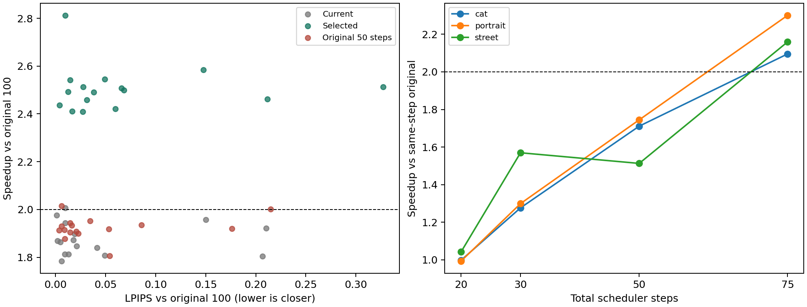
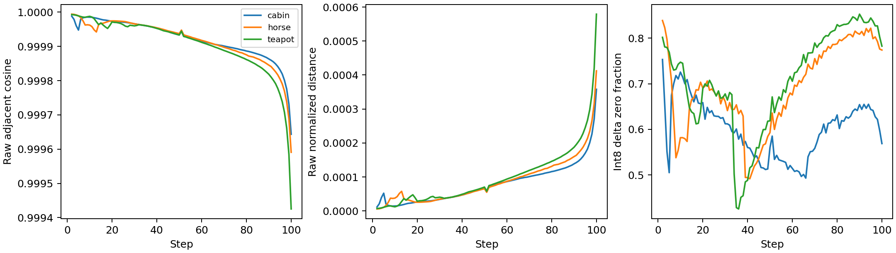
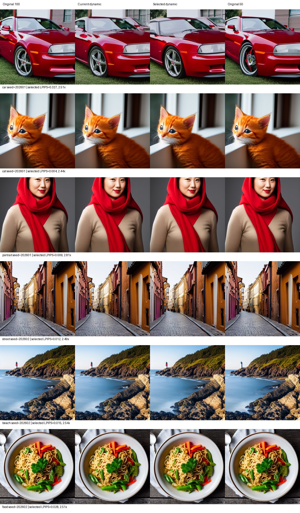

# 时间步相似性加速实验报告 / Temporal Similarity Evaluation

日期：2026-09-14T21:03:13.997605。GPU：NVIDIA GeForce RTX 4060 Laptop GPU。控制后端：pynq。

## 实验范围与计时

- 调参：3种提示词 × 2个种子 × 3种动态参数；另有3次100步原始轨迹采集。
- 独立验证：8种新提示词 × 2个新种子；比较原始100步、现有动态、选定动态和原始50步。
- 其中3种提示词 × 2个种子另跑电脑控制器；步数扫描为3种提示词 × 20/30/50/75步。
- 每组方案执行顺序按固定种子打乱；所有方案统一预热、提示词、种子、512×512分辨率和DPM-Solver采样器。
- 生成计时包含文本编码、扩散、VAE、控制器初始化、特征压缩及板端通信；不包含模型加载、预热、保存PNG、画质评估。
- 轨迹采集运行不计入速度结果；正式运行不自动降级、不重试，异常直接记为失败。
- CLIP变化采用原始余弦尺度；旧报告的CLIP Score乘过100，不能混用。

## 结果 / Results

| 数据集 / Dataset | 时间步 / Steps | 方案 / Variant | 样本 / N | 平均加速 / Mean speedup | 平均UNet / Mean calls | 平均LPIPS / Mean LPIPS | 最差LPIPS / Max LPIPS | 平均CLIP变化 / Mean CLIP delta |
|---|---:|---|---:|---:|---:|---:|---:|---:|
| calibration | 100 | balanced | 6 | 2.226x | 40.8 | 0.0272 | 0.0464 | +0.0018 |
| calibration | 100 | current | 6 | 1.785x | 51.8 | 0.0074 | 0.0147 | +0.0005 |
| calibration | 100 | fast | 6 | 2.395x | 37.8 | 0.0334 | 0.0717 | +0.0017 |
| step_sweep | 20 | selected | 3 | 1.011x | 19.7 | 0.0293 | 0.0880 | +0.0002 |
| step_sweep | 30 | selected | 3 | 1.382x | 21.0 | 0.0425 | 0.0660 | -0.0021 |
| step_sweep | 50 | selected | 3 | 1.656x | 27.3 | 0.0380 | 0.0765 | +0.0009 |
| step_sweep | 75 | selected | 3 | 2.185x | 31.0 | 0.0275 | 0.0713 | -0.0017 |
| validation | 100 | current | 16 | 1.876x | 49.8 | 0.0482 | 0.2102 | -0.0002 |
| validation | 100 | original50 | 16 | 1.923x | 50.0 | 0.0462 | 0.2146 | +0.0001 |
| validation | 100 | selected | 16 | 2.506x | 36.6 | 0.0694 | 0.3272 | -0.0005 |
| validation | 100 | selected_pc | 6 | 2.535x | 36.7 | 0.0240 | 0.0597 | +0.0000 |

选定参数：`fast`，仅使用调参集选择。筛选条件是工程诊断规则（平均LPIPS≤0.10、最差≤0.25、平均CLIP余弦下降≤0.01），不是课题规定的画质验收标准。调参集是否满足：True。

独立验证平均加速 **2.506x**；总基准时间/总动态时间 **2.504x**；达到2x的样本 **16/16**。
按提示词分组重采样的平均加速95%区间：**[2.468, 2.549]x**。该区间反映本批提示词差异，不覆盖不同机器和运行日期。

独立验证是否满足调参时的画质诊断条件：**False**；LPIPS超过0.25的样本：**1/16**。通过调参筛选不等于通过独立验证，不据此替换原有默认参数。
相对原始50步，新动态平均快 **1.304x**；与原始100步的LPIPS比原始50步更好的样本为 **6/16**。

## FPGA实际收益 / FPGA Contribution

逐步回放核对：908步，0处不一致。PC平均判断含压缩 0.130ms；PYNQ平均判断含压缩与往返 1.728ms。
完整生成PC/PYNQ配对：6组；决策序列相同6组；图片像素哈希相同6组。
PYNQ减PC的平均生成耗时：0.0903秒（正数表示PYNQ较慢）。
FPGA确实负责整数相似度/距离判断和跳步状态；整体加速主要来自少执行GPU UNet。ARM报告的kernel时间包含MMIO和轮询，不能称为纯FPGA运算延迟。

## 存储与差异 / Storage and Differences

原始100步平均PyTorch分配显存峰值：2675.4 MiB；选定动态：2675.4 MiB。此指标不是整机GPU显存占用。
动态预测缓存：131072字节；量化参考向量4096字节。未做模型权重量化，不能宣称模型存储缩小。
每步单份FP16 latent为32768字节，去重、2×2池化和INT8后为4096字节，特征载荷减少8倍；相对重复CFG输入为16倍。网络字节统计只含特征载荷，不含TCP/IP头。
选定动态中余弦通过而距离拒绝的次数合计：79。
INT8向量逐步独立缩放，幅值变化可能被消除，因此INT8距离不是原始latent的真实幅值距离；其差值零比例也不能直接当作UNet可跳过的稀疏计算比例。

## 图表 / Figures







## 限制 / Limitations

1. 画质指标衡量与原始图的接近程度，不能证明图像本身正确；应结合图库检查主体、结构和提示词符合程度。
2. 当前验证只有8种独立提示词和每词2个种子；尚不代表所有场景、采样器、分辨率和GPU。
3. 原始50步对照必须共同报告，不能仅以原始100步作为唯一参照。不同步数扫描采用15%预热比例，不能承诺每种步数都达到2倍。
4. 没有实测整机或板卡能量，不宣称节能；FPGA纯运算周期仍需硬件计数器/RTL验证。
5. 动态阈值不等于模型训练；本轮离线调参后固定配置，运行时EMA适应变化。距离门限由调参轨迹候选跳步距离的90%分位数确定。
6. 未实现UNet卷积差分计算、MAC阵列或完整CacheQuant/Ditto复现；这些不是本简介强制指定的路线。

## 复现 / Reproduction

```powershell
conda activate sd_accel
python temporal_evaluation.py --backend pynq
python temporal_report.py experiments/<本次输出目录>
```

`manifest.json`保存环境、提示词、种子、初始候选和源文件哈希；`selected_profile.json`保存选定参数；每组目录保存图像、逐步记录、耗时与画质数据。

## 补充顺序验证 / Counterbalanced Verification

主批次随机顺序只由种子和步数决定，恰好把验证集基准放在最后。补充测试对3种提示词各交换一次先后顺序，且不重新调参；后续实验脚本将提示词也加入顺序种子。
6组补充平均加速 **2.460x**，范围 **2.329–2.537x**。原始先跑平均 **2.454x**，动态先跑平均 **2.466x**。
重复运行图像哈希一致：True。关闭跳步的20步手工扩散与原始pipeline图片像素一致：True。
主批次测量源码另存于 `source_snapshot.zip`；补充测试源码哈希见 `verification/summary.json`。补充数据单独报告，不混入独立验证集的平均数。
